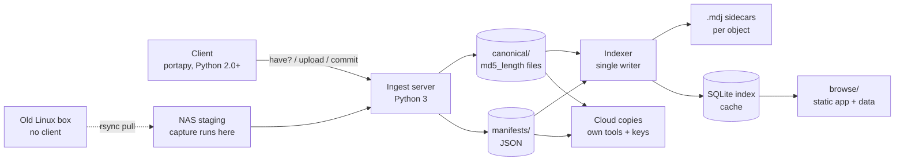
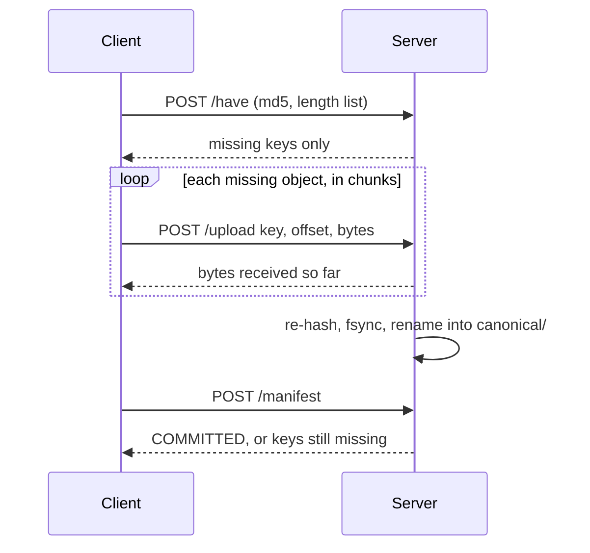

# pybak2 Design

Oct 18, 2026 · @Raoul

## Goal and scope

pybak2 builds one deduplicated archive of every file from every household machine, and an explorable, searchable, media-rich browser interface over it. It is a rewrite of pybak\_nt that keeps its core ideas.

**In scope**

- Back up files from Linux (including very old machines), macOS and Windows to one Linux server (the NAS) on ext4.
- Whole-file deduplication across all machines, keyed by MD5 + length.
- Provenance: every host, path and time at which each unique content was seen.
- Browse by host and path, by extension, by date (year/month/day), by category (photos, videos, …); metadata search; select arbitrary files and download them.
- Copies of the archive to one or more clouds, each using its own tools and encryption.

**Out of scope**

- Restoring a machine or directory to a working state. Permissions, ACLs and extended attributes are captured as data where cheap, never re-applied.
- Encryption on the LAN. Encryption belongs to each cloud copy.
- Block-level (sub-file) deduplication.

## Principles

- **Minimum essential complexity.** Every feature and every dependency must earn its place. Complexity is allowed only in layers that can be thrown away and rebuilt.
- **The store is sacred; everything else is derived.** Objects and manifests are plain files, written once and never modified. The index, thumbnails and browse data are caches rebuilt from them, so a bug there can never lose data.
- **Backups are just files.** Any object can be verified with `md5sum` and opened with ordinary tools, without pybak2.
- **Nothing shared is ever modified.** Concurrency safety comes from immutable files and atomic renames, not from locks.
- **Loss is never silent.** A client that would lose data refuses to run unless given a specifically named flag, and every skipped or damaged file is recorded in the manifest.
- **Trust is proven by verification.** The server re-hashes everything it receives; scheduled checks re-hash the store; a periodic drill restores from a cloud copy.

## Architecture

Clients push content and manifests to the server; everything humans see is generated from the store by a single indexer.



The two stores are sacred (`canonical/` data files and `manifests/`); the per-object `.mdj` sidecars, the index and `browse/` can be deleted and rebuilt at any time. Only the client is constrained to portable Python; the server side is ordinary Python 3 and may use any Python 3 library and JSON freely.

| Component | Language | Runs on | Responsibility |
| --- | --- | --- | --- |
| Client | Portable Python (portapy, 2.0 to 3.x) | Every backed-up machine | Walk, capture names and attributes, hash, upload missing objects, commit manifest |
| Ingest server | Python 3 | NAS | Answer which hashes are missing, accept resumable chunks, verify, commit objects and manifests |
| Indexer | Python 3 | NAS | The only writer of the index; consumes committed manifests |
| Derivers | Python 3 + exiftool, libvips, ffmpeg | NAS | Capture dates, thumbnails, video previews, keyed by object |
| Browse app | Static HTML + JavaScript | Any copy of `browse/` | Explore, search, select, download |
| Cloud copiers | Each cloud's own tool | NAS | Append-only copies of objects and manifests |

## Store layout (canonical/)

The store keeps pybak\_nt's `canonical/` tree unchanged: the MD5 split into two-hex-character directories, then a data file named `<md5>_<length>`, with JSON metadata on the server. New are a directory of immutable JSON manifests and staging areas for uploads.

```
store/
  canonical/c2/c2/30/bb/…/ba/c2c230bb32c51dcd8a06f302cbec2bba_2368512       data, as in pybak_nt
  canonical/c2/c2/30/bb/…/ba/c2c230bb32c51dcd8a06f302cbec2bba_2368512.mdj   JSON sidecar, derived
  manifests/<host>/2026-10-18T020000Z_<rand>.json    one per client run, immutable
  incoming/<md5>_<length>.<client-id>.part           uploads in progress
  quarantine/                                        uploads that failed verification
```

- **Object key:** lowercase hex MD5 + `_` + length in bytes. MD5 + length is accepted as unique for this archive.
- **Fan-out:** the same directory scheme as pybak\_nt (`util.get_data_path`: one level per two hex characters of the MD5), so the existing store is used in place.
- **Data files are content only:** no extension; type comes from the metadata and the index.
- **Commit:** an upload is complete only when the server has re-hashed the `.part` file, fsynced it, and renamed it to its data-file name. A rename onto an existing data file is harmless: same name, same bytes.
- **Manifests are the source of truth** for provenance: one JSON file per client run, written once under a unique name, never modified.
- **`.mdj` sidecars are derived.** Each one merges every sighting of that object (hosts, paths, times) from all manifests, as pybak\_nt's `.mdj` did. Only the indexer writes them, via a uniquely named temp file and rename, and they can be regenerated from `manifests/` at any time.
- **Never delete.** Data files are not garbage-collected. If deletion is ever added, it removes only objects referenced by no manifest and older than a grace period, with no uploads in progress.
- **Optional secondary hash:** the server may record SHA-256 per object in its metadata during ingest, at no network cost.

## Manifest format

On the wire, a client manifest is a line-oriented text file, one record per line, tab-separated, writable with `%` formatting on Python 2.0 and parseable by anything. It is the authoritative record of what was where, when.

- **No JSON or pickle from clients.** JSON needs Python 2.6; pickle is code execution on load and breaks on bytes between Python 2 and 3.
- **Paths are lists of components**, each component hex-encoded (`binascii.hexlify`) and joined with `/`. A component is the exact bytes the OS returned; there is no guessing whether something is already hex.
- **Every line starts with a one-letter record type.** Unknown types are ignored by readers, so the format can grow.
- **The last line is an end marker** with the record count and the MD5 of all preceding bytes, so a truncated manifest is detected.

```
H	format	1
H	host	laptop
H	client-id	3f9c…
H	started	2026-10-18T02:00:00Z
H	platform	darwin|Darwin 19.6.0|x86_64
H	python	2.7.16
H	fs-encoding	utf-8
H	root	2f55736572732f6a6f…
H	flag	allow-lost-unicode-characters
F	2f55…/50686f746f73/494d475f303030312e4a5047	2368512	c2c230bb…	1571234567.25	1571234567.25	-	100644	-
L	2f55…/6c61746573742e6a7067	494d475f303030312e4a5047
S	2f55…/62696766696c652e6d6b76	too-large
E	3	9e107d9d372bb6826bd81d3542a419d6
```

| Type | Fields after the type | Meaning |
| --- | --- | --- |
| `H` | key, value (printable ASCII; paths hex) | Header: format, host, client id, start time, platform, Python version, filesystem-encoding hint, roots, flags in effect, failed self-tests |
| `F` | path, size, md5, mtime, ctime, birth time or `-`, mode (octal), extras or `-` | A regular file whose content is in the store |
| `L` | path, target (hex) | A symlink, recorded, never followed |
| `S` | path, reason | Seen but not backed up: `lossy-name`, `too-large`, `unreadable`, `changed-during-read`, `cloud-placeholder`, `special-file` |
| `E` | record count, md5 of preceding bytes | End marker |

- **Times** are decimal seconds since the epoch, as precise as the interpreter gives. mtime, ctime and birth time are kept separate; "oldest" is decided in the index, not here.
- **Extras** are a hex-encoded list of `key=value` pairs for platform attributes worth keeping (Windows hidden/system/read-only, macOS download-source xattr). Losing them is acceptable; losing content is not.

**Stored form on the server.** When a manifest commits, the server parses and validates the line format and writes it as one immutable JSON file in `manifests/<host>/`, in the same spirit as pybak\_nt's `.mdj` metadata. The original line file is kept beside it for audit. Paths stay as lists of hex components, because JSON strings cannot carry arbitrary bytes.

```
{"format": 1, "host": "laptop", "client_id": "3f9c…", "started": "2026-10-18T02:00:00Z",
 "platform": "darwin|Darwin 19.6.0|x86_64", "python": "2.7.16", "fs_encoding": "utf-8",
 "roots": [["2f55…"]], "flags": ["allow-lost-unicode-characters"],
 "files": [{"path": ["5573657273a…", "50686f746f73", "494d475f303030312e4a5047"],
            "size": 2368512, "md5": "c2c230bb…", "mtime": 1571234567.25,
            "ctime": 1571234567.25, "birth": null, "mode": "100644", "extras": {}}],
 "links": [{"path": […], "target": "494d475f303030312e4a5047"}],
 "skipped": [{"path": […], "reason": "too-large"}]}
```

The per-object `.mdj` sidecar is built from these files by the indexer: `hosts → paths → {oldest, exe, encoding, …}`, the shape pybak\_nt already uses.

## Protocol

Three calls over plain HTTP/1.0-style POSTs with `Content-Length`, simple enough for a raw-socket client on Python 2.0. Content the server already has never crosses the network; interrupted uploads resume where they stopped.



| Call | Request | Response (first line is a status word) |
| --- | --- | --- |
| `POST /have` | Body: lines of `md5<TAB>length` | `OK`, then one line per key the server lacks |
| `POST /upload?key=<md5_length>&client=<id>&offset=<n>` | Body: one chunk (default 4 MiB) | `OK <bytes-so-far>`, `HAVE` (already stored), `COMMITTED`, `BAD-HASH`, or `OFFSET <n>` (resume from n) |
| `POST /manifest?host=<host>&client=<id>` | Body: the manifest | `COMMITTED`, `MISSING` + keys, or `BAD-MANIFEST` |

- **Resume:** the partial file is `incoming/<key>.<client-id>.part`, so a restarted client resumes its own upload. A client that sends the wrong offset gets `OFFSET <n>` and continues from there.
- **Verification:** when the last chunk arrives, the server re-hashes the whole `.part` file. A match is fsynced and renamed into `canonical/` (`COMMITTED`). A mismatch moves it to `quarantine/` (`BAD-HASH`); the client re-hashes the source, retries once, then records `S … changed-during-read`.
- **Manifest commit:** the server checks the end marker and that every `F` record's object exists, then writes the manifest under a unique name in `manifests/<host>/`. Anything missing is returned as `MISSING`, and the client uploads it and retries.
- **Authentication:** each client sends a per-client token in a header, issued once at enrollment. It is plaintext on the LAN, which matches the no-LAN-encryption decision; off-LAN use goes through an SSH tunnel.
- **Timeouts:** every client socket read and write waits through `select.select` with a timeout, since socket timeouts do not exist before Python 2.3.

## Client

The client is written in the portapy subset so that one source file runs on whatever Python is easiest to get onto a machine, from Python 2.0 to current 3.x, on Linux, macOS and Windows. Its dependency surface is kept to six things: `os.listdir`, `os.lstat`, file reads, MD5, `binascii`, and `socket` + `select`.

**Capture rules**

- **Names as bytes.** Directory entries are read as raw bytes (`str` on Python 2, `bytes` on Python 3). On Windows, Python 2.3+ reads Unicode names and encodes them losslessly; Python 3.6+ bytes paths are UTF-8.
- **Own traversal.** `os.listdir` + `os.lstat` with an explicit stack, not recursion. Symlinks are recorded (`L`) and never followed; `(st_dev, st_ino)` pairs break cycles.
- **Hash while reading, check before and after.** The client records size and mtime, hashes the file, then checks size and mtime again. A change means re-hash once, then `S … changed-during-read`.
- **Skip and report, never guess.** Special files, unreadable files, and cloud placeholders (iCloud dataless files, OneDrive recall-on-access) become `S` records.
- **Hash once per run.** The hash computed for `/have` is the one used for upload; the global cache is cleared per run.

**Startup self-tests and the capability gate**

Before backing anything up, the client tests the interpreter it is running on. A gap that would lose data stops the client unless a specifically named flag is given; a gap with a correct workaround is handled and logged. Every flag in effect is written to the manifest header.

| Gap | Detection | Treatment |
| --- | --- | --- |
| No Unicode filenames on Windows (Python < 2.3, or Windows 9x) | `os.path.supports_unicode_filenames` missing or false on Windows | Refuse; `--allow-lost-unicode-characters` |
| No large-file support | Seek and read past 2 GB fail on a test file, or a file over 2 GB cannot be read | Refuse; `--skip-large-files`, each file recorded as `S … too-large` |
| Built-in MD5 wrong or missing | RFC 1321 test vectors | Automatic fallback to pure-Python MD5, with a speed warning |
| No socket timeouts (Python < 2.3) | `socket.socket.settimeout` missing | Automatic: `select.select` before every read and write |
| `hexlify` round-trip fails | Known byte strings | Refuse; no flag |

The refusal message is one line saying what would be lost and what fixes it, for example:

```
pybak: this Python (2.2.3) cannot read Unicode filenames on Windows;
files with such names would be lost. Install Python 2.3 or newer,
or rerun with --allow-lost-unicode-characters to back up the rest.
```

With that flag, files whose names come back damaged (containing `?` and not openable) are recorded as `S … lossy-name`, and the header carries `lossy-names: windows-ansi-codepage`.

**SDK shims to add to portapy:** `listdir_bytes`, `hash_file`, `http_post` (raw socket, streamed body, select-based timeouts), `to_bytes` / `from_bytes`, and the large-file probe. Each is tested in portapy's Docker matrix, with images added for the oldest real target (for example 2.2 and 2.4) next to 2.7 and 3.14.

**No-client fallback:** for a machine where no workable Python exists, the NAS pulls its files with `rsync` over SSH into a staging folder, preserving raw byte names, and runs the same capture code there, recording the source host's locale as the encoding hint.

## Concurrency

Any number of clients can back up at once because no shared file is ever modified; the server can be multi-threaded without locks around the store.

| Rule | What it prevents |
| --- | --- |
| Each upload writes its own `.part` file, named by key and client id | Two clients interleaving bytes in one file |
| Objects appear only by atomic rename after verification | Readers ever seeing a partial or wrong object under its final name |
| Renaming onto an existing object is allowed | Races between two clients finishing the same content: same name, same bytes |
| Provenance is written only in the manifest, after all its objects exist | Metadata claiming content that was never stored |
| Manifests get unique names and are never rewritten | Lost updates from read-modify-write of shared metadata |
| One indexer is the only writer of the index and the .mdj sidecars | Index corruption from concurrent writers |
| No garbage collection while uploads are in progress | Deleting an object a client is about to reference |

These rules replace pybak\_nt's behaviour, which was safe only because `BaseHTTPServer` handled one request at a time: it wrote chunks in place under the final object name, updated a shared `.mdj` per object through a fixed temp-file name, and recorded provenance before content arrived.

## Derived layer: index, search, browse

Everything a person sees is generated from `canonical/` and `manifests/`, keyed so that each unique content is processed once however many hosts, paths and runs it appears in.

**Index (SQLite, rebuildable)**

- Built only from committed manifests by the single indexer, which notices new ones by polling `manifests/` (and optionally inotify as a speed-up).
- Core tables: objects (key, size, type, capture date, dimensions), sightings (object, host, path components, display path, mtime, ctime, birth time, manifest, run time), skipped (host, path, reason).
- Display paths are NFC-normalized with replacement characters for search and display only; raw bytes stay authoritative.
- "Oldest" date per object = EXIF/container capture date if present, else the earliest mtime across sightings.
- Category from the fixed extension table carried over from pybak\_nt's `exts.py`, refined by file magic where the extension is missing or wrong.

**Search**

- Metadata search first: SQLite FTS5 on names and paths, plus filters on host, date range, category, extension, size and camera.
- Content search (text inside documents, image recognition) is optional and later.

**Derivatives, keyed by object**

- Capture date, camera and GPS via exiftool.
- Thumbnails via libvips (including HEIC and camera RAW such as NEF).
- Video poster frames and browser-playable previews via ffmpeg, for formats browsers can't play (AVI, MTS, some HEVC).
- Generated only when missing, so new backups cost work only for new content.

**Browse app (static)**

- A fixed single-page app written once, loading data files generated from the index; no server process needed, works from any copy of `browse/`.
- Data is sharded by month, host and category; each shard records a hash of its inputs and is rebuilt only when they change.
- Views: by host and original path, by extension, by date (year/month/day), by category, duplicates and provenance ("this photo was on these machines at these paths"), skipped files per host.
- Search in the browser: Pagefind or querying the SQLite index over HTTP range requests (prototype both at real scale).
- Download: select any set of files; a JavaScript zip library streams them into one zip in the browser, giving each a unique name inside the archive.

This replaces pybak\_nt's `buildhtml.py`, which edited generated HTML and JSON in place, so its output depended on processing order and could not be rebuilt in parts.

## Cloud copies and verification

Because objects and manifests are immutable files, a cloud copy is append-only: upload what is new, never touch what is there. Each cloud uses its own tool and its own encryption, so a bug in one copy's tooling cannot damage the NAS or the other copies.

- **What is copied:** the `canonical/` data files and `manifests/` only. The `.mdj` sidecars, the index and `browse/` are rebuilt from them.
- **Keys:** each encrypted cloud copy has its own key, stored off-site (password manager plus paper). Losing the NAS must not lose the key.
- **Small-file cost:** one object per unique file means many requests. Exclude junk (caches, `node_modules`, build output) on the clients.

**Verification**

| Check | Frequency | What it proves |
| --- | --- | --- |
| Server re-hash on every upload | Every object | Stored bytes match the claimed key |
| Rolling re-hash of a slice of `canonical/` (`md5sum` against the name) | Nightly, e.g. 2% per night | Disk has not silently corrupted the store |
| Every manifest's `F` objects exist; end markers valid | Nightly | No dangling provenance |
| Last successful run per host | Continuous, shown in browse | A machine that stopped backing up is noticed |
| Restore drill from a cloud copy on another machine | Every few months | The off-site chain works end to end |

## Decisions and rejected alternatives

| Option | Verdict | Reason |
| --- | --- | --- |
| restic (with `--insecure-no-password` on the LAN, `restic copy` to S3) | Rejected as the store | Chunks and packs mean backups are not plain files and need restic to read; large feature surface; both tiers share one program's bugs |
| Forking restic to remove encryption | Rejected | Removes the least risky code, keeps chunking and packing, creates a format only the fork can read |
| UrBackup | Rejected as the store | Plain-file trees with hardlink dedup, but organized by backup run rather than unique content; hardlinks don't copy efficiently to clouds |
| BackupPC 4 | Rejected | Closest pool format, but metadata lives in its own attrib files, Perl/Unix-server-only, slow releases |
| git-annex | Rejected | Good multi-cloud model, but large, and Windows support is beta |
| Immich pointed at the store | Rejected as the UI | Content-addressed storage has no human layout; Immich would lose provenance. Possible later as an extra media view |
| Pickle for manifests or the wire | Rejected | Code execution on load; bytes break between Python 2 and 3 |
| JSON produced by clients | Rejected | Needs Python 2.6; clients send the line format and the server, being Python 3, stores manifests and sidecars as JSON |
| MD5 + length as the key | Accepted | Collisions are not a realistic risk for a household archive; available on Python 2.0; matches pybak\_nt's store |
| Encryption on the LAN | Rejected | No key to lose; encryption belongs to each cloud copy |
| Python 3 server, portapy client | Accepted | Client must run on whatever Python a machine has; the server only needs to run on the NAS |

## Migration and staged plan

**From pybak\_nt.** The existing `canonical/` store is imported read-only and left untouched until the new store passes verification against it.

- **Data files stay where they are.** The new store uses the same `canonical/` layout and `md5_length` names, so existing data files are adopted in place after a verification pass re-hashes each one against its name.
- **Old `.mdj` files become legacy manifests.** Each existing `.mdj` (version 10 schema, older versions via pybak\_nt's migration code) is converted into records in one JSON `legacy` manifest per host: path components, oldest time, executable bit, encoding hint. The old `.mdj` files are kept, renamed aside, until the indexer has regenerated sidecars that agree with them.
- **Kept from pybak\_nt:** the store layout and key, the provenance model, `exts.py`, the `itest_*` corpus (NEF raws, duplicate canonicals, merge cases), and the lesson from `DbUpsertMain.java` that the index is rebuilt from the store.

**Stages.** Each stage is useful on its own; only stage 1 touches data that cannot be regenerated.

1. **Store, protocol, client.** Ingest server, manifest format, portapy client with self-tests and capability gate, filename corpus tests on Linux, macOS and Windows, legacy import.
2. **Index and search.** Indexer, SQLite schema, FTS5 metadata search, nightly verification.
3. **Browse.** Static app, data shards, thumbnails and video previews, zip download.
4. **Later.** Cloud copies, content search, central management GUI.

## Development plan

In order. Each item: what to build → how it is tested. Nothing in a later stage starts until the earlier stage's tests pass on every target interpreter.

**0. Groundwork**

- Repo layout: `client/` (portapy), `server/` (Python 3), `test/`, `corpus/` → CI runs portapy `checkall.py` on `client/`, pytest on `server/`.
- portapy Docker images for the real floor (e.g. 2.2, 2.4) plus 2.7 and 3.14 → a hello-world client prints the same output in every image.
- Filename corpus generator: odd bytes, invalid UTF-8, NFD vs NFC, emoji, 255-byte names, leading/trailing spaces, `?`, `:`, `\`, case-only twins, deep trees, symlink loops, zero-length, >2 GB sparse file → generates identically on each run; checked into `corpus/` as a script, not as files.
- Freeze a copy of a real pybak\_nt `canonical/` sample (from `itest_*`) as a read-only fixture → checksum list stored alongside.

**1. Client SDK shims (portapy)**

- `to_bytes` / `from_bytes` → round-trip tests in every image, including bytes 0x80–0xFF.
- `hexlify` path components → round-trip every corpus name; output identical across images.
- `listdir_bytes` → on Linux corpus, names equal raw bytes from a C-level reference (`ls -f` hexdump); on Windows, Unicode names survive on 2.3+.
- Iterative walk with `lstat`, symlinks recorded not followed, `(dev, ino)` cycle breaking → corpus walk terminates, symlink loop reported once, file count matches `find -P`.
- `hash_file` with built-in MD5 → RFC 1321 vectors; equals `md5sum` on every corpus file.
- Pure-Python MD5 fallback → same vectors; equals built-in on random files; speed measured and logged.
- Size/mtime before-and-after check → test that appends to a file mid-hash gets `changed-during-read`.
- Large-file probe → >2 GB sparse file hashes correctly where supported; probe fails cleanly on a build without LFS.
- `http_post` over raw socket with `select` timeouts → against a test server that stalls, drops mid-body, and returns partial responses; client times out and reports, never hangs.

**2. Client capability gate**

- Self-test runner at startup, results into manifest header → each self-test forced to fail via a test hook; correct refusal or fallback chosen.
- Unicode-filename gate on Windows (`supports_unicode_filenames`) and `--allow-lost-unicode-characters` → Windows image (or mocked platform) on <2.3 refuses with the one-line message; with flag, damaged names become `S … lossy-name`.
- `--skip-large-files` gate → non-LFS build refuses; with flag, each big file is `S … too-large`.
- Exit codes and messages documented → snapshot tests of messages.

**3. Manifest format**

- Line writer in the client (`H`, `F`, `L`, `S`, `E`) → golden-file tests: same corpus produces byte-identical manifests (apart from times and ids) in every image.
- Line parser + validator in the server → rejects truncated files, bad end-marker MD5, unknown required fields; ignores unknown record types.
- Line → JSON converter in the server → round-trip property test: parse(line) → JSON → back to records is lossless.
- Fuzz the parser with random and mutated manifests → never crashes, always accept-or-reject.

**4. Ingest server**

- `canonical/` path function, identical to pybak\_nt's `util.get_data_path` → test against every path in the frozen pybak\_nt fixture.
- `POST /have` → returns only missing keys; empty list, all present, all missing, duplicates in request.
- `POST /upload` writing `incoming/<key>.<client>.part` with offsets → resume after a drop at random offsets; wrong offset gets `OFFSET n`; out-of-order chunk rejected.
- Final verify, fsync, rename into `canonical/` → corrupted chunk ends in `quarantine/` with `BAD-HASH`; good upload appears atomically (a reader polling the path never sees a partial file).
- Two clients uploading the same key at once → both succeed or get `HAVE`; one data file; no `.part` left behind.
- `POST /manifest` → `MISSING` when an `F` object is absent; `COMMITTED` writes JSON + original line file under a unique name; never overwrites.
- Per-client tokens → missing or wrong token rejected; token never logged.
- Threaded server (Python 3 `ThreadingHTTPServer` or similar) → stress test: 10 simulated clients, overlapping content, random drops; afterwards every data file re-hashes to its name and every manifest's objects exist.
- Crash safety → kill the server at random points during the stress test; restart; no corrupt data files, stale `.part` files resumable or cleanable.

**5. End-to-end client run**

- Client main loop: walk → batch `/have` → upload missing → commit manifest → corpus backed up from every image to a test server; manifest lists every corpus entry as `F`, `L` or `S`.
- Second run with no changes → zero bytes uploaded.
- Second run after edits → only changed content uploaded; new manifest written; old one untouched.
- Network chaos (tc/netem or a dropping proxy) → runs complete with resumes; no duplicate data.
- Real machines: one old Linux box, one Mac, one Windows PC → manual run, results compared with `find`/`dir` listings.

**6. Legacy import from pybak\_nt**

- Verification pass over existing `canonical/` → report of files whose MD5 or length disagrees with the name; nothing modified.
- `.mdj` (all historical versions) → legacy JSON manifests per host → every host/path in old `.mdj` appears in new manifests; counts match.
- Old `.mdj` renamed aside, not deleted → test that import is idempotent: running twice produces no new manifests.

**7. Indexer and sidecars**

- Poll `manifests/` for new committed JSON → picks up each manifest exactly once, survives restarts.
- SQLite schema (objects, sightings, skipped) → rebuild from scratch equals incremental build, compared row for row.
- `.mdj` sidecar writer (single writer, temp + rename) → regenerated sidecars match old pybak\_nt `.mdj` content for the fixture.
- Display paths (NFC, replacement chars) → corpus names display; raw bytes preserved in the database.
- Category from `exts.py` + file magic → table-driven tests on corpus and itest files.
- Delete the index and sidecars, rebuild → identical results.

**8. Nightly verification**

- Rolling re-hash of a slice of `canonical/` → a deliberately flipped byte is found within one full cycle and reported.
- Manifest integrity check (end markers, all `F` objects exist) → a deleted data file is reported with every manifest that references it.
- Last-successful-run per host → host that misses N days flagged.

**9. Derivatives**

- exiftool capture date, camera, GPS → sample JPEG, HEIC, NEF, MOV, MP4 with known values.
- libvips thumbnails keyed by object → generated once; second pass does no work; corrupt image recorded, not fatal.
- ffmpeg poster frames and previews for AVI, MTS, HEVC → output plays in Chrome, Firefox, Safari.

**10. Search**

- FTS5 on names and paths plus filters → query tests: substring, extension, host, date range, size, camera.
- Browser-side search prototype: Pagefind vs SQLite over HTTP range requests → measured at real archive size (index size, first-query latency); pick one.

**11. Browse app**

- Data shard generator (month, host, category) with input hashes → adding one manifest rebuilds only the shards it touches.
- Static single-page app: host/path, extension, year/month/day, category, provenance, skipped-files views → click-through tests with a headless browser on a fixture archive.
- Selection + streaming zip download → 1, 100, 5,000 files; duplicate names made unique; memory stays bounded.
- Works from a plain copy of `browse/` on another disk → open from `file://` or a static web server.

**12. Cloud copies**

- Append-only copier of `canonical/` data files + `manifests/` per cloud, each with its own tool and key → dry run lists only new files; re-run uploads nothing.
- Restore drill script: fresh machine, cloud copy + off-site key → rebuild index and browse from the cloud copy; spot-check files by MD5.

**13. Later**

- Client scheduling and a tray/menu icon for "back up now" and "pause".
- Enrollment codes for tokens.
- Content search (document text, image recognition).
- Central management GUI.

## Open questions

- [ ] What is the oldest machine and Python actually in use? It sets the Docker images to test against (for example 2.2, 2.4).
- [ ] Path components in the manifest: hex everywhere (simple, 2× size) or printable ASCII with hex only when needed (smaller, one more rule)?
- [ ] How does the client find the server and get its token: config file, command-line flag, or a one-time enrollment code?
- [ ] Scheduling on clients: cron/launchd/Task Scheduler set up by hand, or a long-running client loop?
- [ ] Does the server record SHA-256 per object from day one?
- [ ] Browse search: Pagefind or SQLite over HTTP range requests, decided by a prototype at real archive size.
- [ ] Excludes: a default list (caches, `node_modules`, trash folders) plus per-host additions; where does it live?
- [ ] Which clouds, and which tool and encryption for each?
